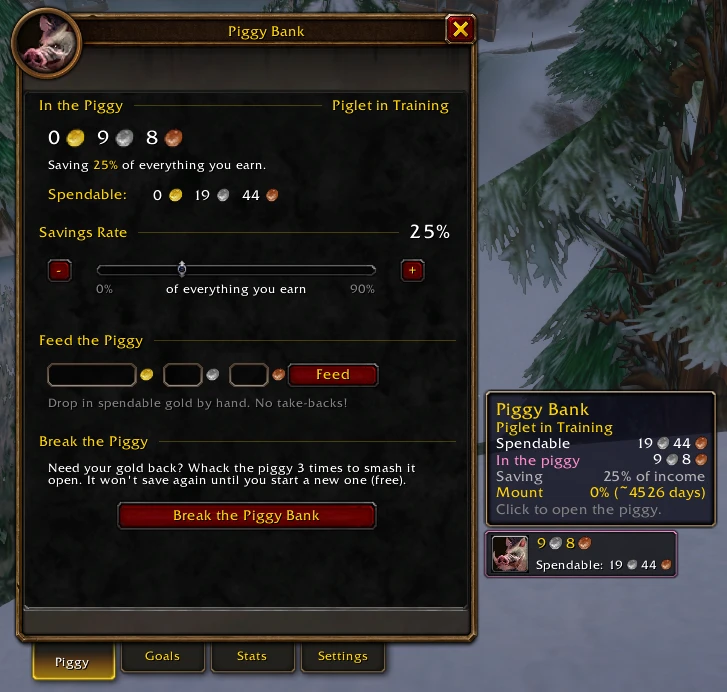
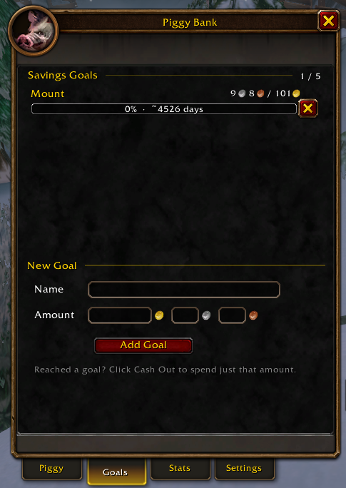
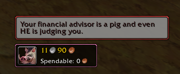
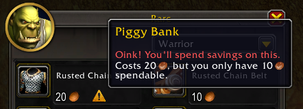
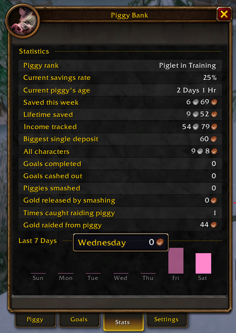
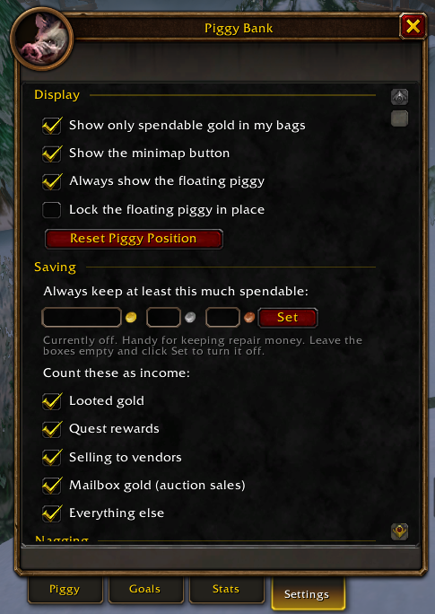

<!-- Paste everything below this line into the CurseForge project description (Markdown mode). -->

# 🐷 Piggy Bank

**Saving gold is hard. Smashing a piggy bank is fun.**

Piggy Bank tucks away a slice of every copper you earn and hides it from your bags. Your bag counter only shows what you can actually spend. When you really need the savings, you have to **smash the piggy** to get them back. And if you dip into the piggy without smashing it? It *will* have something to say about that.

Works with **WoW Forever**, **Classic Era** (Vanilla, Hardcore, Season of Discovery) and **Retail**.

## Why you'll like it

- **Set it and forget it.** Pick a savings rate from 0–90%, and that share of your income goes into the piggy automatically.
- **Out of sight, out of mind.** Your bag gold counter shows only *spendable* gold. Works with the default bags, **Bagnon** and **Baganator**.
- **Saving for something?** Add up to 5 goals, like a mount, a profession or that one overpriced pet. Each goal gets a progress bar and an estimate of how long until you get there. When you reach one, the piggy cheers and a **Cash Out** button spends just that goal's gold.
- **Never caught short.** Set an amount to always keep spendable, like repair money, and the piggy won't save below it. Great for Hardcore.
- **You decide what counts as income.** Looted gold, quest rewards, vendor sales, auction mail and everything else each have their own switch. Gold you take out of the bank or get in a trade never counts.

## The piggy is watching

- **Spending warnings.** Vendors, Repair All, trainers, flight masters and the auction house flag anything that would eat into your savings, *before* you buy it.
- **Get scolded.** Spend your savings anyway and the piggy pops up with one of 26 truly terrible puns.
  > *"Hogger is disappointed in you. And Hogger eats people."*
- **Smash it.** Whack the piggy 3 times to release everything. Starting a new piggy is free and takes one click.

## Watch it grow

- **Piggy ranks.** Climb from *Piglet in Training* to *The Gold Cap Hog* as your lifetime savings grow. Smashing the piggy never costs you a rank.
- **Stats.** A 7-day savings chart, this week's total, lifetime saved, your total across all characters, biggest deposit, piggies smashed, times caught raiding the piggy, and more.

## Fits right in

- **No typing needed.** Click the piggy on your minimap or the gold in your bags, or open **Esc → Options → AddOns → Piggy Bank**. Every setting is in the window.
- **Minimap button** that lines up with your other addons' buttons and works with minimap button bags.
- **Optional floating piggy** that shows your savings on screen.
- **Info bars.** Titan Panel, ElvUI DataTexts, Bazooka, ChocolateBar and other LibDataBroker displays.
- **Translatable.** All text can be translated.

## Slash commands

You don't need them, but they're there:

| Command | What it does |
| --- | --- |
| `/piggy` | Open or close the piggy window |
| `/piggy rate 25` | Save 25% of income (0–90) |
| `/piggy goal 500 New Mount` | Add a goal of 500 gold |
| `/piggy feed 10` | Put 10 gold in by hand |
| `/piggy keep 5` | Always keep 5 gold spendable (`0` turns it off) |
| `/piggy widget` | Show or hide the floating piggy |

## Good to know

Addons can't lock gold, so the piggy is a ledger. The game will still let you spend your savings. You'll just hear about it. 🐷

Savings are tracked per character, and the Stats tab shows your total across all of them.

## Bugs, ideas and translations

Found a bug or have an idea? Open an issue on [GitHub](https://github.com/kota150/PiggyBank/issues). The bug form asks for your game version and any Lua error.

Want Piggy Bank in your language? See [TRANSLATING.md](https://github.com/kota150/PiggyBank/blob/main/TRANSLATING.md). Partial translations are welcome.
