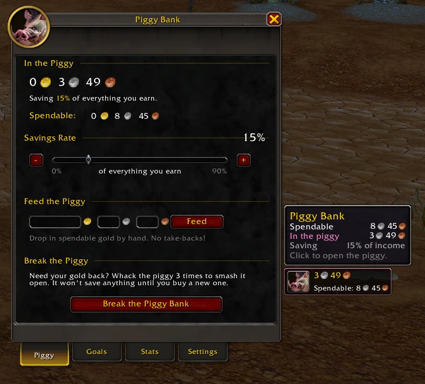
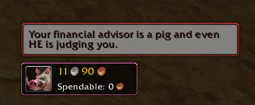
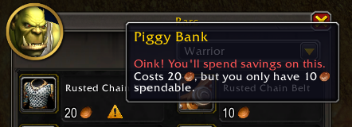
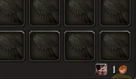
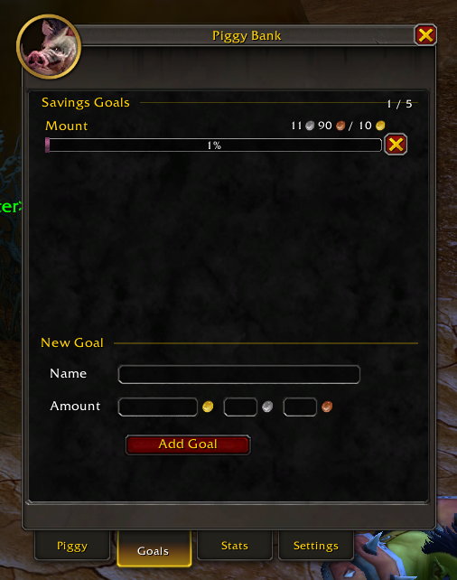
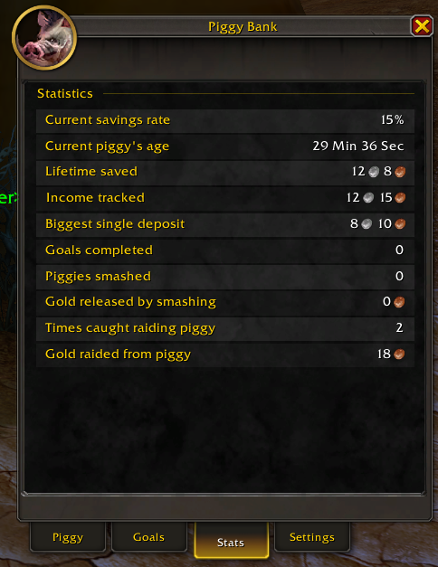
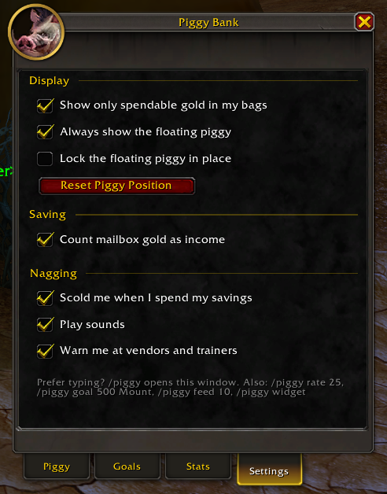

# 🐷 Piggy Bank

A World of Warcraft addon that saves a slice of everything you earn, hides it from your bags, and makes you **smash the piggy** to get it back.

Works with **WoW Forever**, **Classic Era** (Vanilla, Hardcore, Season of Discovery) and **Retail**.

## Features

- **Automatic savings.** Pick a rate from 0–90% and that share of every gold gain goes into the piggy.
- **Hidden gold.** Your bag money counter shows only your *spendable* gold. Hover over it for the full breakdown. Works with the default bags and **Bagnon**.
- **Smart income tracking.** Gold you pull out of your bank, warband bank or guild bank, or get in a trade, isn't counted as earnings. Mailbox gold (auction sales) counts unless you turn it off.
- **Savings goals.** Set up to 5 goals in gold, silver and copper, each with a progress bar. You get a raid-warning cheer when you reach one.
- **Feed the piggy.** Drop in extra gold by hand.
- **Smash it.** Whack the piggy 3 times and confirm to release your savings. A broken piggy stops saving until you buy a new one.
- **Get scolded.** Spend into your savings and the piggy pops up to tell you off with one of 26 painfully cheesy puns.
  > *"That gold was soulbound to the piggy! BoP = Bacon on Purpose!"*
- **Spending warnings.** A ⚠ icon and tooltip flag anything that would dip into your savings at vendors (including Repair All), trainers, flight masters and the auction house. Buying auction house commodities (or clicking Bid / Buyout in Classic) pops up a heads-up before you confirm.
- **Stats.** Lifetime saved, biggest deposit, goals completed, piggies smashed, times caught raiding the piggy, and more.
- **Floating piggy.** An optional on-screen piggy showing your savings. It's off by default, and you can lock it in place.

## Screenshots

| Getting scolded | Vendor warning | Bags show only spendable gold |
| --- | --- | --- |
|  |  |  |

| Goals | Stats | Settings |
| --- | --- | --- |
|  |  |  |

## How it works (and its limits)

WoW addons can't move or lock gold, so the piggy is a ledger. It keeps track of how much of your gold counts as savings and changes what the bag counter shows. The game will still let you spend it. You'll just hear about it.

Other addons or windows that show your gold will still show your real total.

## Installation

1. Download this repo (**Code → Download ZIP**) and extract it.
2. Make sure the folder is named `PiggyBank`. Rename it if it's `PiggyBank-main`.
3. Put it in your AddOns folder:
   - **WoW Forever:** `World of Warcraft/_forever_/Interface/AddOns/`
   - **Classic Era:** `World of Warcraft/_classic_era_/Interface/AddOns/`
   - **Retail:** `World of Warcraft/_retail_/Interface/AddOns/`
4. Restart WoW or type `/reload`.

If the AddOns list says Piggy Bank is out of date, tick **Load out-of-date AddOns**.

## Usage

Open the piggy any of these ways:

- Type `/piggy`.
- Click the addon menu button by the minimap.
- Go to **Esc → Options → AddOns → Piggy Bank**.
- Click your bag gold counter or the floating piggy.

Every setting is in the window, across the **Piggy**, **Goals**, **Stats** and **Settings** tabs. Slash commands are optional:

| Command | What it does |
| --- | --- |
| `/piggy` | Open or close the piggy window |
| `/piggy rate 25` | Save 25% of income (0–90) |
| `/piggy goal 500 New Mount` | Add a goal of 500 gold |
| `/piggy feed 10` | Put 10 gold in by hand |
| `/piggy widget` | Show or hide the floating piggy |

Savings are stored **per character**.

## License

Public domain. See [LICENSE](LICENSE).
